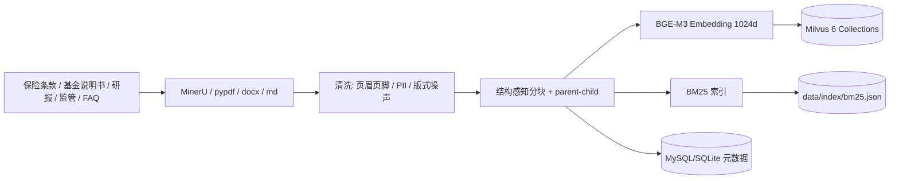
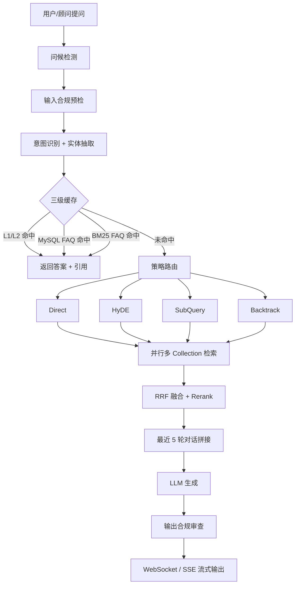

# 小智财答

> 面向金融理财场景的 RAG 智能问答与条款审查平台。  
> 统一接入基金、保险、债券、银行理财、股票和宏观研报，提供可追溯的产品分析、市场解读和合规审查。

## 1. 项目定位

本项目把分散的基金说明书、保险条款、研报、监管材料和 FAQ 统一成可追溯的知识库，为智能问答工作台提供：

- **条款级问答**：等待期、免责、理赔材料、现金价值、续保条件等；
- **多资产分析**：基金/保险/债券/银行理财/股票/宏观研报的跨库检索；
- **适当性约束**：按用户 C1-C5 风险等级过滤产品，避免高风险产品推荐给低风险客户；
- **合规可审计**：输入预检 + 输出审查 + 引用溯源 + 全量审计日志；
- **低延迟流式体验**：WebSocket / SSE 逐 token 输出，Redis + 进程内多级缓存。

当前仓库包含一套可离线运行的完整实现，以及 39 部国家金融监督管理总局官方法规 PDF、示例基金/保险文档、FAQ 和研报，用于端到端验证。生产环境需要接入机构授权的产品库、研报库和内部知识库，并切换 BGE-M3、Milvus、DeepSeek/Qwen。

业务场景、实现范围和接入边界见 [docs/project-background.md](docs/project-background.md)。

## 2. 核心能力

| 能力       | 实现                                                                     |
| -------- | ---------------------------------------------------------------------- |
| 文档解析     | PDF/Word/HTML/Markdown/CSV/XLSX；MinerU 可选，保留页码与章节               |
| 图片知识     | PDF 按页、Markdown/DOCX 按位置标记提取图片，落盘后随引用返回并在回答中回显                         |
| 用户图片识别   | 上传图片 → 视觉模型 OCR/内容描述 → 识别文本参与 RAG → 返回原图和识别结果                          |
| 合同文件审查   | 上传保险条款/合同，检索免责、等待期、理赔、退保等条款，输出风险与待核对项                                  |
| 离线知识库构建  | 按法规/产品/研报/FAQ 四类目录统计、去重、目标缺口审计，并一键进入索引                                 |
| 结构感知分块   | 标题/条款边界优先，句边界滑动窗口，表格不拆断，parent-child 上下文扩展                             |
| 六库隔离     | `equity`、`fund`、`insurance`、`bond`、`bank_wealth`、`macro` 六个 Collection |
| 研报分区     | `industry` 元数据（消费/医药/科技/金融/制造）+ `publish_date` 时效过滤                    |
| 混合检索     | BGE-M3/哈希向量 + BM25，RRF 融合，启发式或 bge-reranker 精排                         |
| 动态路由     | Direct / HyDE / SubQuery / Backtrack，按意图、问题复杂度、对话历史选择                  |
| 并行检索     | 子查询跨 Collection 并行召回，合并后统一 RRF + Rerank                                |
| 多级缓存     | 进程内 TTL-LRU → Redis → FAQ 库/BM25，按问题、画像指纹和知识库版本隔离                  |
| 用户画像     | 10 题风险评估问卷 → C1-C5；画像分桶、版本化、受控 query 扩写、风险硬过滤、缓存隔离和审计快照 |
| 账号与权限    | 本地注册/登录、PBKDF2 密码哈希、HMAC 短期 Token、登录限流、账号级会话与审计隔离 |
| 合规审查     | 输入预检（违规请求）、规则引擎（收益承诺/绝对化/适当性）、可选 LLM 复核                                |
| 低置信度兜底   | 置信度不足时在线 LLM 进入受控通用分析，并标注“知识库未命中”；离线模式先确认一次意图，仍无依据则明确结束，不循环追问；不伪造引用 |
| 依据与来源     | 回答下方按“法规依据 / 数据来源”展示条款、页码和官方链接，便于核验 |
| 可追溯      | 每个结论 `[n]` 引用，返回文档、章节、页码、原文片段；审计表可回放                                   |
| 流式接口     | `POST /v1/chat/stream`（SSE）与 `WS /v1/ws/chat`                          |
| SFT 数据准备 | 字段校验、PII 清洗、合规过滤、质量分、SimHash 去重、按来源分组切分、ChatML 导出                      |
| 工程化      | FastAPI、异步、限流、API Key/Bearer Token、Prometheus 指标、Docker Compose、pytest、评测/压测脚本 |

## 3. 架构

### 3.1 离线索引



### 3.2 在线问答



### 3.3 六个 Collection

| Collection    | 内容              | 关键元数据                                   |
| ------------- | --------------- | --------------------------------------- |
| `insurance`   | 保险条款、产品说明书      | 险种、条款号、生效日期、风险等级                        |
| `fund`        | 基金合同/招募说明书/产品资料 | 风险等级 R1-R5、行业、费率                        |
| `bond`        | 债券与固收产品         | 久期、信用等级、风险等级                            |
| `bank_wealth` | 银行理财            | 风险等级、期限、开放规则                            |
| `equity`      | 股票/权益研究         | 行业、发布日期                                 |
| `macro`       | 宏观研报、监管材料       | `industry` 分区、`publish_date`、`doc_type` |

> 研报按 `industry` 打标并支持 `publish_date >= cutoff` 过滤；仓库内示例文档仅用于工程验证，生产接入机构授权的研报、基金净值和新闻增量源。

## 4. 快速开始

### 4.1 本地运行（无 GPU / 无 API Key）

```powershell
python -m venv .venv
.\.venv\Scripts\Activate.ps1
pip install -e .

$env:PYTHONPATH = "src"
python scripts/ingest.py --path data/raw data/kb/regulations data/kb/products data/kb/research --rebuild
uvicorn huixiaoan.service.app:app --host 0.0.0.0 --port 8000
```

或直接提问：

```powershell
python scripts/ask.py "医疗险的年度免赔额是多少？" --risk-level C3
```

默认配置：

- `embedding.provider=hashing`：确定性 1024 维哈希向量，仅用于本地/CI；
- `vector_store.backend=local`：文件持久化；
- `llm.provider=offline`：抽取式兜底；
- 首次启动会自动索引 `data/raw` 以及 `data/kb` 下已存在的法规/产品/研报目录，并导入 FAQ。

### 4.2 切换生产模型

```powershell
$env:HUIXIAOAN_EMBEDDING_PROVIDER = "bge-m3"
$env:HUIXIAOAN_VECTOR_BACKEND = "milvus"
$env:HUIXIAOAN_MILVUS_URI = "http://127.0.0.1:19530"
$env:HUIXIAOAN_LLM_PROVIDER = "deepseek"     # 或 qwen
$env:HUIXIAOAN_LLM_BASE_URL = "https://api.deepseek.com/v1"
$env:HUIXIAOAN_LLM_MODEL = "deepseek-chat"
$env:HUIXIAOAN_LLM_API_KEY = "sk-..."
$env:HUIXIAOAN_REDIS_URL = "redis://127.0.0.1:6379/0"
```

Qwen/vLLM 示例：

```powershell
$env:HUIXIAOAN_LLM_PROVIDER = "qwen"
$env:HUIXIAOAN_LLM_BASE_URL = "http://127.0.0.1:8001/v1"
$env:HUIXIAOAN_LLM_MODEL = "Qwen2.5-14B-Instruct"
```

安装可选依赖：

```powershell
pip install -e ".[ml]"
```

### 4.3 Docker Compose

```powershell
$env:HUIXIAOAN_LLM_API_KEY = "sk-..."
docker compose up -d --build
curl http://localhost:8000/healthz
```

会启动 etcd、MinIO、Milvus、Redis、MySQL 和 API。首次启动会自动建表、建 Collection 并索引 `data/raw`。

### 4.4 同一局域网访问

启动时绑定 `0.0.0.0`，不要绑定 `127.0.0.1`：

```powershell
python -m uvicorn huixiaoan.service.app:app --host 0.0.0.0 --port 8000
```

用 `ipconfig` 找到本机局域网 IPv4，例如 `192.168.34.143`，同一局域网设备访问：

```text
http://192.168.34.143:8000/
```

Windows 防火墙需要放行 TCP 8000（管理员 PowerShell）：

```powershell
New-NetFirewallRule -DisplayName "Huixiaoan RAG 8000" `
  -Direction Inbound -Protocol TCP -LocalPort 8000 `
  -Action Allow -Profile Private
```

如果仍然无法访问，检查设备是否在同一子网、是否连接到公司/VPN 隔离网络，以及是否绑定到了错误网卡 IP。局域网部署建议只开放 Private 网络，并设置 `HUIXIAOAN_API_KEY` 控制访问。

## 5. API

### 注册 / 登录

```bash
curl -X POST http://localhost:8000/v1/auth/register \
  -H "Content-Type: application/json" \
  -d '{"username":"advisor001","password":"FinTest2026","display_name":"王顾问"}'

curl -X POST http://localhost:8000/v1/auth/login \
  -H "Content-Type: application/json" \
  -d '{"username":"advisor001","password":"FinTest2026"}'
```

登录后携带：

```http
Authorization: Bearer <access_token>
```

登录状态下服务端以账号画像为准，客户端传入的 `user_id` / `risk_level` 不会覆盖真实身份。注册登录、Token、画像和会话隔离说明见 [docs/auth.md](docs/auth.md)。

### 普通问答

```bash
curl -X POST http://localhost:8000/v1/chat \
  -H "Content-Type: application/json" \
  -H "Authorization: Bearer $HUIXIAOAN_ACCESS_TOKEN" \
  -H "X-API-Key: $HUIXIAOAN_API_KEY" \
  -d '{
    "question": "客户风险等级C2，可以推荐R4产品吗？",
    "session_id": "advisor-001",
    "domain": "all",
    "profile": {"user_id": "u001", "risk_level": "C2", "investment_experience": "3年"}
  }'
```

返回包含 `answer`、`citations`、`confidence`、`intent`、`strategy`、`compliance`、`latency_ms`。

`domain` 可选 `all` / `fund` / `insurance` / `bank_wealth`；法规类问题会优先检索监管库，不受产品域限制。

### 流式

```bash
curl -N -X POST http://localhost:8000/v1/chat/stream \
  -H "Content-Type: application/json" \
  -d '{"question":"消费板块最近趋势怎么样？","session_id":"s1"}'
```

WebSocket：

```javascript
const ws = new WebSocket("ws://localhost:8000/v1/ws/chat");
ws.onopen = () => ws.send(JSON.stringify({
  question: "消费板块现在值得配置吗？",
  session_id: "s1",
  profile: { user_id: "u1", risk_level: "C3" }
}));
ws.onmessage = (event) => console.log(JSON.parse(event.data));
```

事件流：`meta` → `delta`* → `done`；合规拦截时追加 `replace` 事件。

### 用户图片

工作台点击「图片」上传图片；接口也支持在 `/v1/chat` 请求体中增加：

```json
{"image_base64": "...", "image_mime": "image/png"}
```

视觉模型配置和完整调用说明见 [docs/image-understanding.md](docs/image-understanding.md)。

### 合同/条款文件

工作台点击「文」上传 PDF/DOCX/Markdown/TXT/HTML，系统会检索免责、等待期、理赔、退保、续保等条款并输出初步风险审查。接口为 `POST /v1/chat/file`，说明见 [docs/document-review.md](docs/document-review.md)。

### 管理与可观测

| 接口                             | 用途                   |
| ------------------------------ | -------------------- |
| `GET /healthz` / `GET /readyz` | 健康检查、就绪检查            |
| `GET /metrics`                 | Prometheus 指标        |
| `POST /v1/auth/register`       | 注册并签发 Token          |
| `POST /v1/auth/login`          | 登录并签发 Token          |
| `GET /v1/auth/me`              | 当前账号与风险画像            |
| `PATCH /v1/auth/profile`       | 更新账号风险画像             |
| `GET /v1/images/{image_id}`    | 返回文档中提取的原始图片         |
| `POST /v1/chat/file`           | 上传合同/条款文件并生成初步审查报告   |
| `DELETE /v1/sessions/{id}`     | 清空指定会话的服务端上下文        |
| `GET /v1/profile/questions`    | 获取 10 题风险评估问卷        |
| `POST /v1/profile/assess`      | 问卷答案 → C1-C5 用户画像    |
| `POST /v1/ingest`              | 指定路径增量/全量索引          |
| `POST /v1/ingest/upload`       | 上传 PDF/DOCX/MD 并异步索引 |
| `GET /v1/ingest/{task_id}`     | 索引任务状态               |
| `GET /v1/audit/{request_id}`   | 审计回放                 |
| `POST /v1/feedback`            | 有用/无用反馈              |

## 6. 评测

```powershell
python scripts/eval.py --mode both --dataset data/eval/qa.jsonl
python scripts/load_test.py --requests 2000 --concurrency 100
```

当前仓库内置 **22 条测试评测问题**，使用 `hashing + offline` 跑出的本地结果：

| 指标                |       结果 | 说明                             |
| ----------------- | -------: | ------------------------------ |
| Recall@5          |   1.0000 | 22 条小样本，doc/article/section 命中 |
| MRR@5             |   0.8674 | 正确依据的平均排名                      |
| nDCG@5            |   0.9609 | 排序质量                           |
| 答案关键词覆盖率          |   0.8409 | 抽取式答案的覆盖情况                     |
| Faithfulness-lite |   0.6913 | 答案句子与引用上下文的词项支撑                |
| 合规通过率             |   1.0000 | 规则引擎 + 引用/免责声明                 |
| P50 延迟            | 27.13 ms | 离线模型、单机、无网络调用                  |

这些数字**不能直接等同于生产指标**。生产环境应使用 BGE-M3 + bge-reranker + DeepSeek/Qwen，并在至少 500 条真实、脱敏、双人标注的评测集上重新测量召回率、答案准确率、幻觉率与 P95 延迟。详见 [docs/evaluation.md](docs/evaluation.md)。

本地单机压测基线（`hashing + offline`，300 请求、50 并发、热问题复用缓存）：

```text
success=300  error=0  RPS=47.59  P50=0.94s  P95=2.24s
```

该结果只说明接口、并发和缓存链路可工作；生产需要按实际峰值并发配置多副本、独立 Milvus/Redis/LLM 集群，并做分档压测。

### 6.1 SFT 数据准备

```powershell
python scripts/prepare_sft.py `
  --input data/sft/raw/all.jsonl `
  --out data/sft/processed `
  --target 60000 `
  --min-quality 65
```

输出 instruction JSONL、ChatML JSONL 和 `manifest.json`。仓库自带的 `data/sft/seed.jsonl` 只有 8 条合成样例，`manifest` 会明确写出与 60,000 条目标的缺口；真实数据需要来自授权来源并由分析师复核。详见 [docs/data-preparation.md](docs/data-preparation.md) 和 [docs/sft-labeling-guide.md](docs/sft-labeling-guide.md)。

### 6.2 离线金融知识库

```powershell
python scripts/build_kb.py
python scripts/build_kb.py --ingest --rebuild
```

`data/kb/sources.yaml` 用于登记数据源和可选目标；未配置目标时只统计实际文件。`manifest.json` 会显示当前有效数量、重复数和错误数。仓库不包含未授权数据，也不会用生成文本冒充真实语料。详见 [docs/offline-kb.md](docs/offline-kb.md)。

## 7. 目录

```text
src/huixiaoan/
  ingestion/       解析、清洗、结构感知分块、索引流水线
  indexing/        Embedding、Milvus/本地向量库、BM25、FAQ、Collection 路由
  query/           意图识别、实体抽取、HyDE/SubQuery/Backtrack 路由
  retrieval/       混合召回、RRF、Rerank、置信度
  generation/      Prompt、LLM 客户端、答案编排、流式输出
  compliance/      输入预检、输出合规审查、免责声明
  evaluation/      Recall/MRR/nDCG/Faithfulness-lite
  dataprep/        SFT 清洗、合规过滤、质量分、去重、切分、导出
  service/         FastAPI、WebSocket、限流、指标、依赖装配
  sync/            Wind/基金/新闻增量同步适配层
scripts/           ingest / ask / eval / load_test / sync
configs/           默认配置与金融领域词典
data/raw/          测试语料（生产替换为授权文档）
data/sft/          SFT 种子数据与处理后数据
tests/             单元测试 + 端到端测试
docs/              架构、评测、运维、数据处理说明
web/               智能问答工作台（左侧固定、右侧独立滚动）
```

## 8. 关键设计

**为什么分六个 Collection？** 资产类别的召回分布差异大，分库可以独立设置索引、容量和权限；查询时按意图路由，避免股票基金污染保险条款召回。研报在 `macro` 内用 `industry` 元数据分区，SubQuery 可以只检索消费板块。

**为什么 RRF 而不是分数加权？** 向量余弦相似度和 BM25 分数量纲不同，直接加权需要大量标注调参；RRF 只依赖排名，冷启动更稳。精排阶段再用 bge-reranker 或启发式词项覆盖做二次排序。

**如何抑制幻觉？** 检索置信度阈值 + 强制引用 + 受控兜底 + 输出合规审查 + 引用一致性校验。检索不足时不把结果当作条款原文；在线 LLM 会明确标注“知识库未命中，以下为通用分析”，离线模式先复述并确认一次用户意图，仍无可靠依据时明确说明无法确认并停止追问。监管文件标题会优先按法规意图路由，避免因标题含“基金/保险”被误判为产品咨询。

**如何做适当性？** 用户画像给出 C1-C5；检索阶段对产品库加 `risk_level in R1..Ck` 过滤；生成后再检查产品风险等级与用户等级，超限直接拦截或给出风险提示。

**如何支撑高并发？** API 无状态，Redis 共享缓存，Milvus/MySQL 独立扩展，LLM 客户端带并发信号量和重试；入口有限流和 API Key。按实际峰值、峰均比和 LLM 上游限流做多副本压测，不能靠单机声明。详见 [docs/runbook.md](docs/runbook.md)。

**图片如何处理？** PDF 图片按页码关联到对应 chunk；Markdown/DOCX 使用 `[[IMAGE:id]]` 标记关联。图片落盘到 `data/images`，引用返回 `/v1/images/{id}`，回答末尾追加原始图片 Markdown，前端渲染为缩略图。复杂浮动排版建议走 MinerU。

**容灾与数据增长怎么处理？** Redis 不可用时降级 L1/FAQ；MySQL 不可用时切本地 SQLite；Milvus 不可用时切本地向量库；审计采用有界队列 + 批量写 + spool，数据库恢复后重放；审计/会话按保留周期清理，长期数据归档到对象存储。查询日志和向量库分开治理，避免“每次查询写主库”把系统拖垮。详见 [docs/resilience-and-scale.md](docs/resilience-and-scale.md)。

## 9. 已知限制

- 仓库内的示例基金/保险文档仅用于测试，不能用于真实投保、理赔或投资判断；
- 本地 `hashing` 向量仅用于离线运行，语义能力弱于 BGE-M3；
- 离线抽取式模型不是生产生成模型，答案可读性和归纳能力有限；
- `BM25` 与 FAQ 检索为进程内实现，超大规模建议切换 Elasticsearch/OpenSearch；
- MySQL/SQLite 共用同一套轻量仓储封装，生产需补充连接池、迁移和备份策略；
- 合规规则是工程基线，不能替代持牌机构的法律/合规审核。

## 10. 文档

- [架构与数据流](docs/architecture.md)
- [用户图片识别](docs/image-understanding.md)
- [合同/条款文件审查](docs/document-review.md)
- [离线知识库构建](docs/offline-kb.md)
- [产品数据获取与入库](docs/product-data-ingestion.md)
- [容灾、降级与数据增长](docs/resilience-and-scale.md)
- [测试规范与用例](docs/testing.md)
- [账号、登录与身份隔离](docs/auth.md)
- [会话生命周期与空会话治理](docs/session-lifecycle.md)
- [用户画像与检索策略](docs/profile-policy.md)
- [数据规模、来源与处理](docs/data-sources.md)
- [评测方法与指标口径](docs/evaluation.md)
- [部署与运维手册](docs/runbook.md)
- [模型服务与量化/LoRA](docs/model-serving.md)
- [SFT 数据准备](docs/data-preparation.md)
- [SFT 标注规范](docs/sft-labeling-guide.md)
