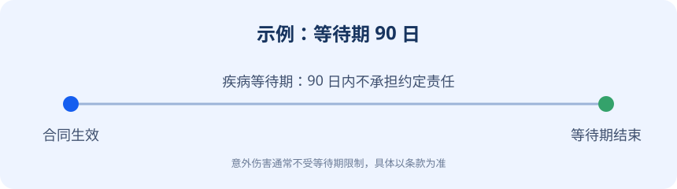

# 平安福终身寿险（示例条款）

> 本文为演示用虚构条款，仅用于 RAG 系统测试，不构成真实保险合同内容。

## 第一章 保险合同构成

### 第一条 合同构成

本保险合同由保险单、保险条款、投保单、与本合同有关的投保文件、合法有效的声明、批注、批单以及其他书面协议共同构成。上述文件是本合同不可分割的组成部分。

### 第二条 投保年龄与保险期间

本合同的投保年龄为出生满二十八日至五十五周岁。保险期间为终身，自合同生效日零时起至被保险人身故之日二十四时止。

### 第三条 等待期

自本合同生效之日起九十日内为等待期。被保险人在等待期内因疾病导致身故的，本公司不承担身故保险金责任，并向投保人无息退还已交保险费。因意外伤害导致身故的，不受等待期限制。

### 第四条 保险责任

在本合同有效期内，本公司承担下列保险责任：

一、身故保险金。被保险人身故，本公司按合同基本保险金额给付身故保险金，合同终止。

二、重大疾病保险金。被保险人经医院确诊初次发生本合同约定的重大疾病，本公司按基本保险金额给付重大疾病保险金。重大疾病保险金给付后，身故保险金责任按合同约定相应减少。

三、轻症疾病保险金。被保险人经医院确诊初次发生本合同约定的轻症疾病，本公司按基本保险金额的百分之二十给付轻症疾病保险金，每种轻症疾病限给付一次。

### 第五条 责任免除

因下列情形之一导致被保险人身故或患病的，本公司不承担给付保险金的责任：

一、投保人对被保险人的故意杀害、故意伤害；

二、被保险人故意犯罪或者抗拒依法采取的刑事强制措施；

三、被保险人自本合同成立或者合同效力恢复之日起二年内自杀，但自杀时为无民事行为能力人的除外；

四、被保险人主动吸食或者注射毒品；

五、被保险人酒后驾驶、无合法有效驾驶证驾驶，或者驾驶无合法有效行驶证的机动车；

六、战争、军事冲突、暴乱或者武装叛乱；

七、核爆炸、核辐射或者核污染。

### 第六条 犹豫期

自投保人签收保险合同之日起二十日内为犹豫期。投保人在犹豫期内解除合同的，本公司无息退还已交保险费。犹豫期后解除合同的，本公司按照合同约定退还现金价值，投保人可能承担一定损失。

### 第七条 宽限期

分期支付保险费的，投保人支付首期保险费后，除合同另有约定外，如果到期未支付保险费，自保险费约定支付日的次日零时起六十日为宽限期。宽限期内发生的保险事故，本公司仍承担保险责任，但在给付保险金时会扣减欠交的保险费。

## 第二章 理赔与合同管理

### 第八条 保险事故通知

投保人、被保险人或者受益人知道保险事故发生后，应当在十日内通知本公司。因不可抗力导致通知延迟的，应当在不可抗力消除后及时通知。

### 第九条 保险金申请材料

申请身故保险金时，申请人应当提交保险金给付申请书、保险合同、申请人的有效身份证件、被保险人的死亡证明、户籍注销证明，以及本公司合理要求的其他证明和资料。

申请重大疾病保险金时，申请人应当提交保险金给付申请书、保险合同、申请人的有效身份证件、医院出具的诊断证明、病理检查报告及其他医学检查资料。

### 第十条 核定时限

本公司收到完整的保险金申请材料后，应当在三十日内作出核定；情形复杂的，应当在六十日内作出核定，但合同另有约定的除外。对属于保险责任的，本公司在作出核定后三日内履行给付保险金义务。

### 第十一条 如实告知

订立本合同时，本公司就被保险人的有关情况提出询问的，投保人应当如实告知。投保人故意或者因重大过失未履行如实告知义务，足以影响本公司决定是否同意承保或者提高保险费率的，本公司有权依法解除合同。

### 第十二条 现金价值

现金价值是指保险合同所具有的价值，通常体现为投保人解除合同时，由本公司退还的那部分金额。现金价值按照合同附表的约定计算，在保险期间前期通常低于已交保险费。
